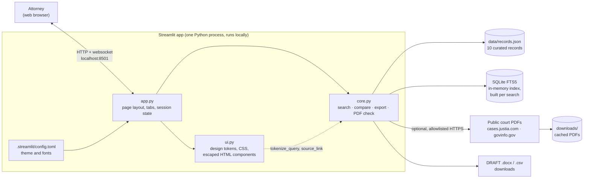
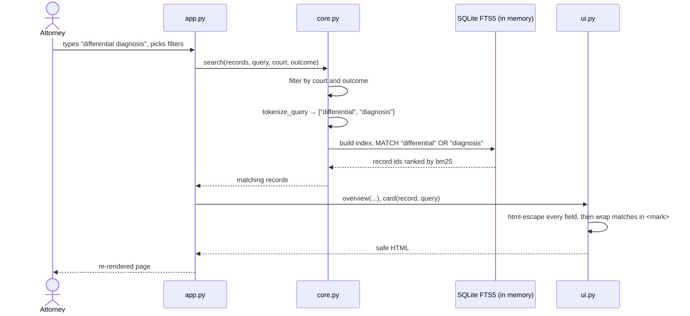

# Argument Atlas: Architecture

Argument Atlas is a single-process Python app with three layers:

- **Interface:** a Streamlit UI, in `app.py` and `ui.py`.
- **Core logic:** plain Python, in `core.py`, with no UI code in it.
- **Data:** one JSON file of curated records, in `data/records.json`.

Search runs fully offline. The only network call is an optional download of a public court PDF, which the user starts.

For the non-technical summary, see [OVERVIEW.md](OVERVIEW.md).

## System diagram



`app.py` holds all the page structure and state. `ui.py` turns records into safe HTML. `core.py` has no Streamlit import, so the same logic also runs in `cli_demo.py` and the tests.

## Components

| File | Lines | Responsibility | Key functions |
| --- | --- | --- | --- |
| `app.py` | ~160 | Page layout (masthead, three tabs, footer), widgets, session state, callbacks | `toggle_compare`, `clear_filters`, `set_query` |
| `ui.py` | ~390 | Design tokens and CSS. HTML fragments with every value escaped. Search-term highlighting. Icons. | `card`, `steps`, `compare_grid`, `overview`, `case_cards`, `highlight`, `badge` |
| `core.py` | ~160 | Load and validate records, keyword search, compare selection, Word export, PDF download and anchor check | `load_records`, `search`, `compare_rows`, `word_comparison`, `download_public_pdf`, `validate_anchor` |
| `.streamlit/config.toml` | ~40 | Theme: colours, fonts (EB Garamond, Lato, JetBrains Mono), corner radius, minimal toolbar | — |
| `data/records.json` | 10 records | The curated dataset | — |
| `cli_demo.py` | ~10 | Terminal search demo that needs no Streamlit | — |
| `tests/test_core.py` | 6 tests | Core behaviour tests | see [Testing](#testing) |

## How a search works



Streamlit re-runs `app.py` top to bottom on every interaction. That is cheap here, because the dataset is 10 records and the index is rebuilt in memory each time. `st.session_state` keeps state between runs: the query, the filters and the compare selection.

If the local SQLite build lacks FTS5, `search` falls back to a plain term-count ranking. That keeps search working on any Python install.

## Data model

Each record in `data/records.json` is a flat object. `load_records` rejects the file if any record is missing a required field or repeats an `id`.

| Field | Example | Required |
| --- | --- | --- |
| `id` | `scott-sevin` | yes, unique |
| `case_id`, `case_name` | `scott-2021`, `Scott v. Dyno Nobel, Inc.` | `case_name` yes |
| `court`, `jurisdiction`, `date`, `docket` | `E.D. Missouri`, `Missouri`, `2021-05-04`, `4:16-cv-01440` | — |
| `expert`, `moving_party` | `Carla Sevin`, `Defendant` | — |
| `issue` | `Differential diagnosis and pulmonary causation` | — |
| `argument`, `opposition` | the court's description of each side | — |
| `court_reasoning` | why the court ruled as it did | yes |
| `outcome` | `Denied` · `Granted` · `Granted in part` | yes |
| `scope_note` | what the ruling did and did not decide | — |
| `topics` | `["differential diagnosis", "methodology"]` | — |
| `source_url`, `source_page` | public order PDF, page number | yes |
| `order_document`, `motion_document`, `source_type` | `231`, `125`, `Court order` | — |
| `anchor` | a short phrase that appears on `source_page` | used by the PDF check |

## Security and safety controls

| Risk | Control | Where |
| --- | --- | --- |
| Script injection through record text or the search box | Every value is passed through `html.escape` before display. Highlighting escapes first, then adds `<mark>`. Only `https://` links are emitted. | `ui.highlight`, `ui.safe_url`, all `ui.*` builders |
| Search-syntax injection | The query is reduced to plain words (at most 12) before it reaches FTS5, so users cannot type FTS operators. | `core.tokenize_query` |
| SQL injection | The match string and limit go in as bound parameters, and the index lives in memory. | `core.search` |
| Fetching arbitrary URLs | Downloads are HTTPS-only, from two allowlisted hosts. Redirects are not followed. The size cap is 20 MB, and the file must start with `%PDF-`. | `core.download_public_pdf` |
| Mistaking output for legal advice | Exports are marked DRAFT with a "not legal advice" banner, and provenance notices appear on every page. | `core.word_comparison`, `ui.boundary` |
| Confidential data | None is stored. The dataset is public court orders only, with no credentials and no firm systems. | — |

## Testing

| Test | What it proves |
| --- | --- |
| `test_data_ids_and_real_source_shape` | 10 records across 4 cases load, every source is a Justia HTTPS link, and every page number is valid |
| `test_search_relevant_results` | "differential diagnosis" returns both the Sevin and Norsworthy rulings |
| `test_search_filters_and_injection` | Court and outcome filters work, and search-syntax input (`OR`, `NOT`, quotes) is neutralized |
| `test_compare_selection_and_page_links` | Compare returns the chosen rulings, and links point to the cited PDF page |
| `test_word_output` | The Word export builds a valid .docx file |
| `test_public_pdf_url_allowlist` | Plain-HTTP and non-allowlisted hosts are refused |

Run them with `python -m pytest tests -q`.

On Windows, `test_public_pdf_url_allowlist` currently errors with a `PermissionError` on the pytest temp folder. This is an environment issue, not a product bug. The other 5 tests pass.

The UI was verified with Streamlit's `AppTest`, which loads the app and drives the search, filter and compare interactions headlessly. It was also checked with browser screenshots at desktop (1440 px) and phone (390 px) widths.

## Running it

```powershell
py -m venv .venv
.venv\Scripts\Activate.ps1
python -m pip install -r requirements.txt
streamlit run app.py          # opens http://localhost:8501
python cli_demo.py "differential diagnosis"   # terminal demo, no Streamlit needed
```

Requirements: Python 3.10+ and Streamlit 1.66 or later. The UI uses recent widgets such as `st.pills`, `st.segmented_control` and horizontal containers. The other dependencies are pandas, PyMuPDF (PDF check), python-docx (Word export), requests (PDF download) and pytest.

## Scaling path

The layers split cleanly, so most next steps replace a single box in the system diagram:

- **More data:** the JSON file becomes a database or document store. `load_records` is the only reader to change.
- **AI extraction:** a new offline pipeline turns PDFs into reviewed records. The app keeps reading approved records only.
- **Semantic search:** `core.search` gets a vector or hybrid ranker behind the same function signature.
- **Pilot hosting:** the same app deploys to an internal host with firm sign-in. Production scale would likely move the UI to a web framework that calls `core.py` as an API.
